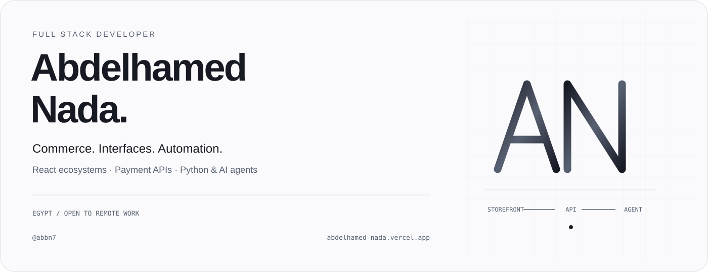
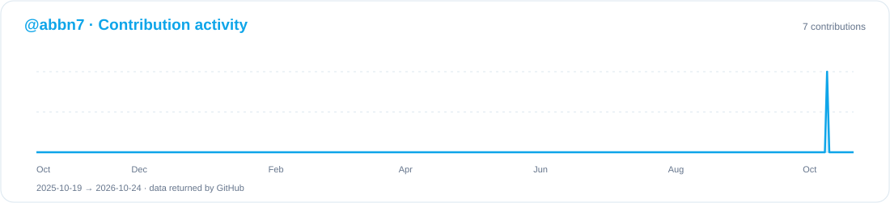

<picture>

  <source media="(max-width: 640px) and (prefers-color-scheme: dark)" srcset="assets/hero-mobile-dark.svg">
  <source media="(max-width: 640px) and (prefers-color-scheme: light)" srcset="assets/hero-mobile-light.svg">
  <source media="(prefers-color-scheme: dark)" srcset="assets/hero-dark.svg">
  <source media="(prefers-color-scheme: light)" srcset="assets/hero-light.svg">
  
</picture>

<a href="README.md">English</a> · <a href="https://abdelhamed-nada.vercel.app/">الموقع الشخصي</a> · <a href="assets/Abdelhamed-Nada-CV.pdf">السيرة الذاتية</a>

# عبد الحميد ندا

مطور Full Stack من مصر، متاح للعمل عن بُعد. أركز على منصات التجارة الإلكترونية SaaS، وواجهات React، وأتمتة Python. أبني REST APIs وأنظمة المصادقة وتكاملات الدفع ووكلاء الذكاء الاصطناعي، مع عمل على عزل بيانات المتاجر ومعاملات قواعد البيانات والاختبارات من البداية إلى النهاية.

## المشاريع الهندسية

### VÉRA Commerce

منصة لإنشاء وإدارة المتاجر الإلكترونية، تضم ثلاث واجهات متجر، ولوحات للتجار، ودعم العربية والإنجليزية، وعزل بيانات المتاجر في SQLite. تشمل Google OAuth مع PKCE، ومطابقة اشتراكات Paymob، واختبارات للمصادقة وعزل المتاجر وإتمام الطلبات.

[عرض المشروع](https://abdelhamed-nada.vercel.app/projects/vera) · [السورس](https://github.com/202402972-stack/vera)

لقطات المشروع من موقعي تعرض التطبيق باستخدام حسابات وكتالوجات تجريبية؛ ولا تمثل مبيعات عملاء أو عمليات دفع إنتاجية.

### StoreKit

متجر مبني باستخدام Next.js وSupabase/PostgreSQL وDrizzle ORM، مع Stripe Checkout والتحقق من توقيع webhooks ومنع تكرار معالجتها وتحديث الطلبات داخل معاملات قاعدة البيانات.

[السورس — ريبو خاص](https://github.com/abbn7/storekit-ecommerce)

### My AI Agent

مساعد Telegram يعتمد على نماذج اللغة، عبر تطوير مشروع NanoBot مفتوح المصدر باستخدام Python، وإضافة أدوات متصفح Playwright وأدوات CLI وإعداد نشر Docker.

[السورس — ريبو خاص](https://github.com/abbn7/my-agent)

### Vanish Mail

تطبيق بريد مؤقت يدعم خمسة صناديق mail.tm حية، واستخراج OTP بالعربية والإنجليزية، وحذف البريد من الخادم. يستخدم Zustand وTanStack Query، مع تعقيم HTML باستخدام DOMPurify وحجب الصور الخارجية افتراضيًا وتقييد إنشاء الحسابات.

[دراسة المشروع](https://abdelhamed-nada.vercel.app/projects/vanish-mail) · [الموقع](https://temporary-zeta-one.vercel.app/)

### GitHub Management Telegram Bot

بوت لإدارة مستودعات GitHub وملفات ZIP من Telegram، مع تشفير بيانات الاعتماد وتأكيد الحذف، ونشر باستخدام Docker على Railway.

[دراسة المشروع](https://abdelhamed-nada.vercel.app/projects/github-management-telegram-bot) · [الموقع](https://giit-website.vercel.app/)

### Reelkeep

بوت Telegram لتنزيل وسائط TikTok وInstagram العامة، يدعم العربية والإنجليزية والتنزيل على دفعات. يستخدم طوابير asyncio وتزامنًا محدودًا وإعادة المحاولة وحفظ الحالة في SQLite.

[دراسة المشروع](https://abdelhamed-nada.vercel.app/projects/reelkeep) · [الموقع](https://reels-landing-zeta.vercel.app/)

### واجهات WebGL ثنائية اللغة

واجهات React باستخدام GLSL مخصص، وإدارة تكيفية لأداء GPU، ودعم العربية والإنجليزية وتقليل الحركة.

[Marmo Verde](https://abdelhamed-nada.vercel.app/projects/green-webgl) · [Newabdate Performance](https://abdelhamed-nada.vercel.app/projects/newabdate-performance) · [Glass Morphic Brilliance](https://abdelhamed-nada.vercel.app/projects/glass-morphic-brilliance)

## التعليم واللغات

- جامعة طنطا — بكالوريوس علوم الحاسب والذكاء الاصطناعي، 2024 حتى الآن.
- جامعة فاروس بالإسكندرية — دراسة علوم الحاسب، 2022–2024.
- العربية: اللغة الأم. الإنجليزية: مستوى مهني.

## المهارات التقنية

| Area | Technologies |
| :--- | :--- |
| Languages | TypeScript, JavaScript, Python, SQL, HTML5, CSS3 |
| Frontend | React, Next.js, TanStack Start, Tailwind CSS, Zustand, TanStack Query, Three.js, WebGL / GLSL |
| Backend & data | Node.js, Express, REST APIs, PostgreSQL, SQLite, Supabase, Drizzle ORM |
| AI & automation | LLM APIs, NanoBot, LiteLLM, Playwright, Telegram bots, asyncio |
| Integrations & deployment | OAuth, Stripe, Paymob, Git, Docker, GitHub Actions, Vercel, Railway |

## نشاط GitHub

هذا الرسم يخص حساب `abbn7` فقط، ويتحدث من بيانات GitHub الفعلية.

<picture>

  <source media="(prefers-color-scheme: dark)" srcset="assets/activity-dark.svg">
  <source media="(prefers-color-scheme: light)" srcset="assets/activity-light.svg">
  
</picture>

## التواصل

[الموقع](https://abdelhamed-nada.vercel.app/) · [LinkedIn](https://www.linkedin.com/in/abdelhamed-nada-030528324/) · [البريد](mailto:dior53634@gmail.com) · [WhatsApp](https://wa.me/201096144345) · [السيرة الذاتية](assets/Abdelhamed-Nada-CV.pdf)

