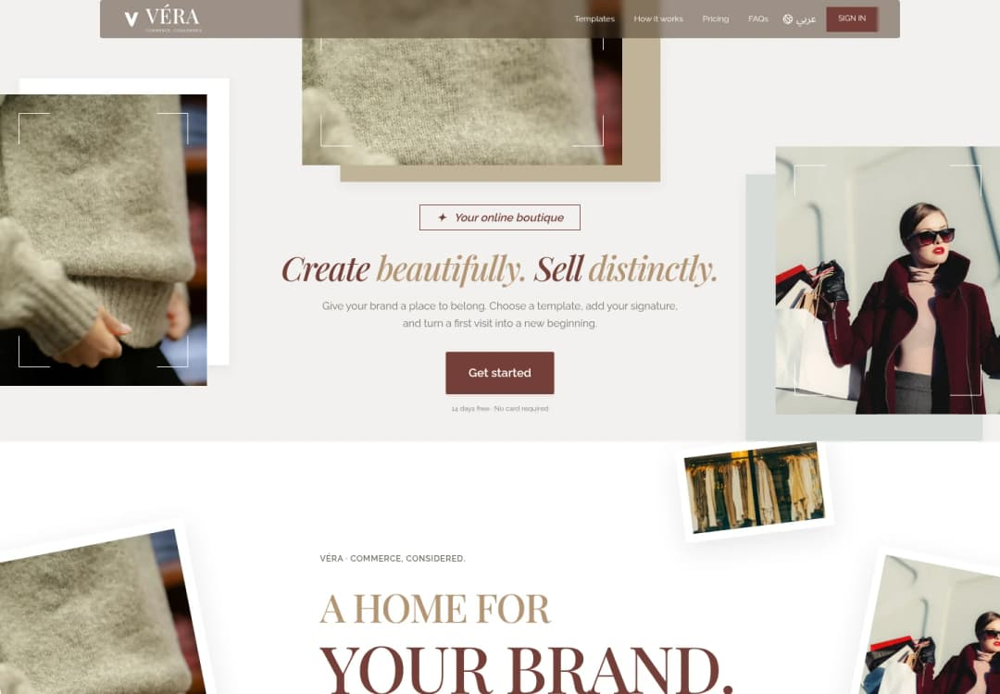
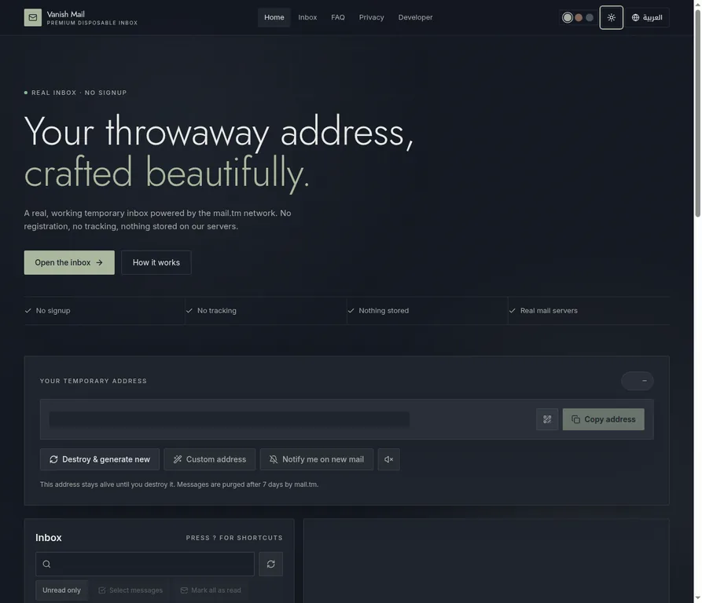
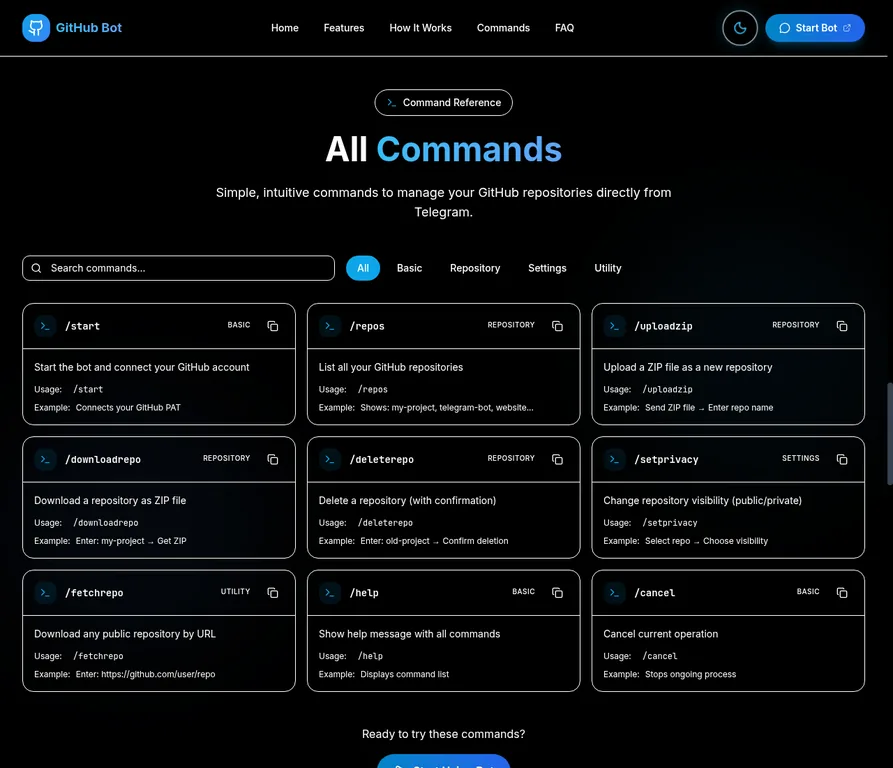
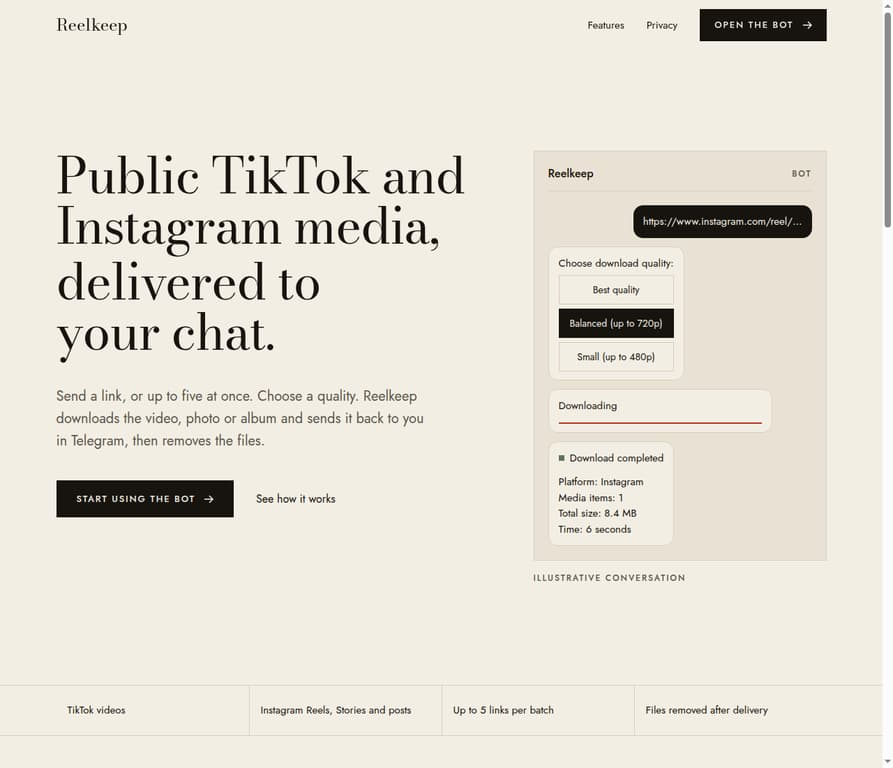
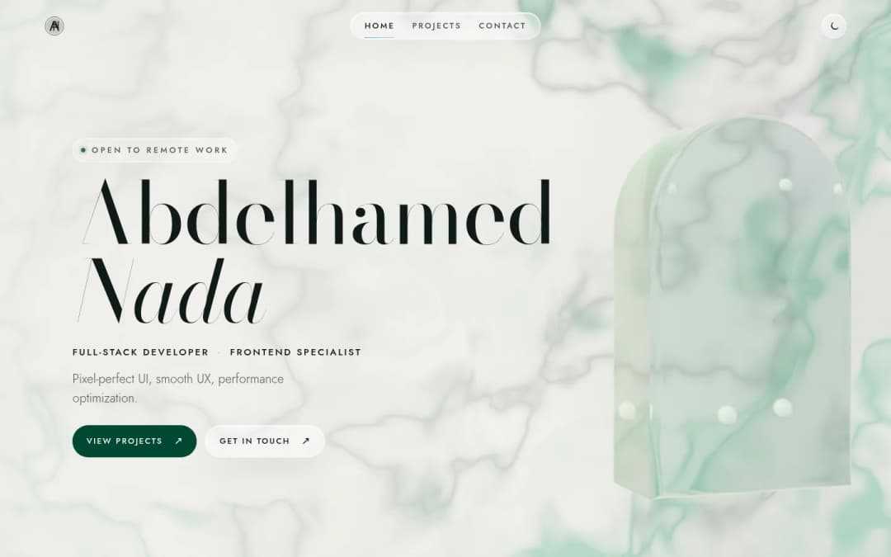
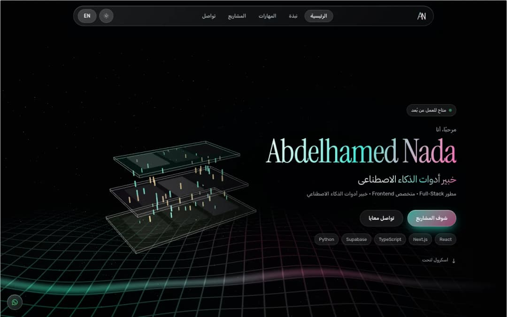

<picture>

  <source media="(max-width: 640px) and (prefers-color-scheme: dark)" srcset="assets/hero-mobile-dark.svg">
  <source media="(max-width: 640px) and (prefers-color-scheme: light)" srcset="assets/hero-mobile-light.svg">
  <source media="(prefers-color-scheme: dark)" srcset="assets/hero-dark.svg">
  <source media="(prefers-color-scheme: light)" srcset="assets/hero-light.svg">
  
</picture>

<a href="README.ar.md">العربية</a> · <a href="https://abdelhamed-nada.vercel.app/">Portfolio</a> · <a href="assets/Abdelhamed-Nada-CV.pdf">Download CV</a> · <a href="https://www.linkedin.com/in/abdelhamed-nada-030528324/">LinkedIn</a> · <a href="mailto:dior53634@gmail.com">Email</a>

## About me

Full-stack developer focused on e-commerce SaaS, React interfaces, and Python automation. I build REST APIs, authentication, payment integrations, and LLM-powered agents, with project work in tenant isolation, database transactions, and end-to-end testing.

Based in **Egypt**, open to **remote work**. Arabic is my native language; I use English professionally.

### What I build

| Commerce systems | Interface engineering | AI & automation |
| :--- | :--- | :--- |
| Bilingual storefronts, merchant dashboards, tenant isolation, and payment workflows. | React interfaces, custom GLSL shaders, adaptive GPU rendering, and reduced-motion support. | LLM-powered assistants, browser tools, Telegram bots, and resilient asynchronous queues. |

## Selected engineering work

<picture>

  <source media="(prefers-color-scheme: dark)" srcset="assets/work-dark.svg">
  <source media="(prefers-color-scheme: light)" srcset="assets/work-light.svg">
  
</picture>

The projects below come from my CV and portfolio. Open a case study to inspect the implementation and screenshots.

### VÉRA Commerce

**Store-building platform · E-commerce SaaS · 2026**

A bilingual commerce platform covering store setup, storefront customization, merchant operations, and platform subscriptions.

- Three React storefront templates with Arabic/English layouts, merchant dashboards, inventory, and order tracking.
- Tenant-scoped SQLite storage, Google OAuth with PKCE, and Paymob subscription reconciliation.
- Node.js and Playwright tests for authentication, tenant isolation, and checkout.

**Built with:** React · Node.js · SQLite · OAuth · Paymob · Playwright

[Case study](https://abdelhamed-nada.vercel.app/projects/vera) · [Source](https://github.com/202402972-stack/vera)

Actual application screenshot from my portfolio. Demonstration accounts and catalog fixtures; no customer revenue or production payment activity is implied.

### StoreKit

**E-commerce & payment APIs · 2025**

A configurable Next.js storefront with transactional order processing and payment integration.

- Supabase / PostgreSQL data layer with Drizzle ORM.
- Stripe Checkout with signature-verified, idempotent webhooks and transactional order updates.

**Built with:** Next.js · TypeScript · PostgreSQL · Supabase · Drizzle · Stripe

[Source (private repository)](https://github.com/abbn7/storekit-ecommerce)

### My AI Agent

**LLM & browser automation · 2025**

An LLM-powered Telegram assistant built by extending the open-source NanoBot project in Python.

- Playwright browser tools and platform CLI wrappers.
- Docker deployment configuration for the assistant.

**Built with:** Python · NanoBot · LLM APIs · Playwright · Telegram · Docker

[Source (private repository)](https://github.com/abbn7/my-agent)

### Vanish Mail

**Full-stack disposable inbox · 2025**

A bilingual temporary email application with mailbox controls and privacy-conscious message rendering.

- Five live mail.tm inboxes, Arabic/English OTP extraction, and server-side deletion.
- Zustand and TanStack Query for asynchronous state.
- DOMPurify sanitization, remote images blocked by default, and rate-limited account creation.

**Built with:** React · TanStack Start · Zustand · TanStack Query · mail.tm · DOMPurify

[Case study](https://abdelhamed-nada.vercel.app/projects/vanish-mail) · [Live website](https://temporary-zeta-one.vercel.app/)

### GitHub Management Telegram Bot

**Repository automation · 2024**

A Telegram interface for repository management and ZIP workflows.

- Encrypted credentials and explicit confirmation before deletion.
- Python implementation deployed with Docker on Railway.

**Built with:** Python · python-telegram-bot · PyGithub · Docker · Railway

[Case study](https://abdelhamed-nada.vercel.app/projects/github-management-telegram-bot) · [Live website](https://giit-website.vercel.app/) · [Source (private repository)](https://github.com/abbn7/GIT5)

### Reelkeep

**Telegram media automation · 2024**

A bilingual Telegram bot for public TikTok and Instagram media, with batch downloads and resilient delivery.

- asyncio queues, bounded concurrency, retries, and SQLite persistence.
- A dedicated product website and asynchronous media delivery workflows.

**Built with:** Python · asyncio · Telegram · SQLite

[Case study](https://abdelhamed-nada.vercel.app/projects/reelkeep) · [Live website](https://reels-landing-zeta.vercel.app/)

## Bilingual WebGL interfaces

<picture>

  <source media="(prefers-color-scheme: dark)" srcset="assets/interfaces-dark.svg">
  <source media="(prefers-color-scheme: light)" srcset="assets/interfaces-light.svg">
  
</picture>

Custom GLSL shaders, adaptive GPU rendering, Arabic/English layouts, and reduced-motion support across React interfaces.

### [Marmo Verde](https://abdelhamed-nada.vercel.app/projects/green-webgl)

Procedural marble, a refractive glass arch, and a light-to-dark theme shift.

### [Newabdate Performance](https://abdelhamed-nada.vercel.app/projects/newabdate-performance)

A luminous 3D glass hero, bilingual storytelling, and carefully budgeted motion.

### [Glass Morphic Brilliance](https://abdelhamed-nada.vercel.app/projects/glass-morphic-brilliance)

A bilingual portfolio built around translucent 3D layers, light, and motion.

## Technical skills

<picture>

  <source media="(prefers-color-scheme: dark)" srcset="assets/stack-dark.svg">
  <source media="(prefers-color-scheme: light)" srcset="assets/stack-light.svg">
  
</picture>

| Area | Technologies |
| :--- | :--- |
| **Languages** | TypeScript, JavaScript, Python, SQL, HTML5, CSS3 |
| **Frontend** | React, Next.js, TanStack Start, Tailwind CSS, Zustand, TanStack Query, Three.js, WebGL / GLSL |
| **Backend & data** | Node.js, Express, REST APIs, PostgreSQL, SQLite, Supabase, Drizzle ORM |
| **AI & automation** | LLM APIs, NanoBot, LiteLLM, Playwright, Telegram bots, asyncio |
| **Integrations & deployment** | OAuth, Stripe, Paymob, Git, Docker, GitHub Actions, Vercel, Railway |

## Education & languages

- **Tanta University** — B.Sc. Computer Science and AI, 2024–present.
- **Pharos University in Alexandria** — Computer Science studies, 2022–2024.
- **Arabic:** native. **English:** professional.

## GitHub activity

<picture>

  <source media="(prefers-color-scheme: dark)" srcset="assets/activity-dark.svg">
  <source media="(prefers-color-scheme: light)" srcset="assets/activity-light.svg">
  
</picture>

This calendar belongs to **abbn7**. It is generated from GitHub data and refreshed by this repository’s workflow. Private repository names and source code are never included. If an update fails, the last successful calendar is retained.

## Let’s connect

I’m open to remote work involving e-commerce platforms, React interfaces, Python automation, and AI agents.

[Portfolio](https://abdelhamed-nada.vercel.app/) · [LinkedIn](https://www.linkedin.com/in/abdelhamed-nada-030528324/) · [Email](mailto:dior53634@gmail.com) · [WhatsApp](https://wa.me/201096144345) · [CV](assets/Abdelhamed-Nada-CV.pdf)

---

Abdelhamed Nada · [@abbn7](https://github.com/abbn7) · Full Stack Developer
